# Documentation

The Security Profiles Operator (SPO) provides:

- A `SeccompProfile` CRD to store seccomp profiles.
- An `AppArmorProfile` CRD to store AppArmor profiles.
- A `SelinuxProfile` CRD to store SELinux profiles, and a `RawSelinuxProfile`
  CRD for policies written directly in CIL.
- A `ProfileBinding` CRD to bind security profiles to pods.
- A `ProfileRecording` CRD to record security profiles from workloads.
- A `SecurityProfilesOperatorDaemon` (SPOD) CRD to configure the operator and
  its per-node daemon.
- A `SecurityProfileNodeStatus` CRD reporting the installation state of each
  profile on each node.

The CRDs have these short names for `kubectl`, and belong to the `spo`
category, so `kubectl get spo -A` lists the objects of all of them:

| Kind                             | Short name |
|----------------------------------|------------|
| `SeccompProfile`                 | `sp`       |
| `AppArmorProfile`                | `aa`       |
| `SelinuxProfile`                 | `selp`     |
| `RawSelinuxProfile`              | `rselp`    |
| `ProfileBinding`                 | `pb`       |
| `ProfileRecording`               | `prec`     |
| `SecurityProfilesOperatorDaemon` | `spod`     |
| `SecurityProfileNodeStatus`      | `spns`     |

The operator also provides:

- Synchronization of seccomp, AppArmor and SELinux profiles across all worker
  nodes.
- Metrics endpoints.
- A command line interface, `spoc`, for use cases outside of Kubernetes.

## Guides

- [Installation](installation.md): installing,
  [upgrading](installation.md#upgrading) and
  [uninstalling](installation.md#uninstalling) the operator
- [Configuration](configuration.md): enabling the optional features and
  configuring the operator through the SPOD
- [Security Profiles](profiles.md): creating and using seccomp, AppArmor and
  SELinux profiles, base profiles and profile bindings
- [Recording](recording.md): recording profiles from workloads with the log
  enricher or the BPF recorder
- [Command Line Interface (CLI)](cli.md): using `spoc` for standalone profile
  management
- [Command Line Reference](reference/security-profiles-operator.md): flags and
  environment variables of the operator binary; see also the
  [spoc reference](reference/spoc.md)
- [Metrics](metrics.md): available metrics and Prometheus integration
- [Troubleshooting](troubleshooting.md): debugging, profiling and
  OpenShift-specific notes
- [Audit Logging Guide](audit-logging-guide.md): auditing in-pod activity with
  the JSON enricher
- [Security Model](security-model.md): the permissions each feature requires
- [Verifying Releases](verification.md): checking signatures, SBOMs and
  provenance of released artifacts
- [Migration Guide: API v1 Graduation](migration-guide-v1.md): API version
  changes, enum normalization and the required upgrade path through 1.0.x

## Project

- [Development](hacking.md)
- [Release Process](release.md)
- [Base Profiles Release Process](release-baseprofiles.md)
- [Container Images](verification.md#container-image): the released images
  below `registry.k8s.io/security-profiles-operator`, see also the
  [staging images](verification.md#staging-images)
- [Testgrid Dashboard](https://testgrid.k8s.io/sig-node-security-profiles-operator)
- History: the original [RFC](history/RFC.md), [user stories](history/user-stories.md)
  and [personas](history/personas.md) of the project, kept for reference. They
  describe the plans at the start of the project, not the current features.

## Architecture



The diagram is generated from its Mermaid source
[`architecture.mmd`](architecture.mmd) with the
[Mermaid CLI](https://github.com/mermaid-js/mermaid-cli), update both together.
The configuration [`architecture-config.json`](architecture-config.json) keeps
the font a system font, so that the SVG embeds no web fonts:

```shell
mmdc -c doc/architecture-config.json -i doc/architecture.mmd -o doc/architecture.svg -b white
```

The operator consists of three components, which run in the operator namespace:

- The **manager** (Deployment `security-profiles-operator`) watches the SPOD
  configuration and creates the daemon and the webhook from it. It also merges
  recorded profiles, aggregates the per node state of each profile into its
  status, and deletes the seccomp profiles which the SPOD allow lists reject.
- The **daemon** (DaemonSet `spod`) runs on every node. It installs the
  seccomp, AppArmor and SELinux profiles on the node, the latter through
  `selinuxd`, and reports their state as `SecurityProfileNodeStatus`. Its
  optional containers record profiles (`bpf-recorder`, `log-enricher`) and
  audit in-pod activity (`json-enricher`).
- The **webhook** (Deployment `security-profiles-operator-webhook`) admits
  pods: it applies the profiles of `ProfileBinding` objects, marks the pods of
  a `ProfileRecording` for recording, and adds the metadata which the JSON
  enricher needs for `kubectl exec` and node debugging sessions. It also
  validates `RawSelinuxProfile` objects.

## Glossary

- **SPOD**: the `SecurityProfilesOperatorDaemon` object named `spod` in the
  operator namespace, which configures the operator, see
  [Configuration](configuration.md).
- **Daemon**: the pods of the `spod` DaemonSet, which install the profiles on
  each node.
- **Node status**: a `SecurityProfileNodeStatus` object, the state of one
  profile on one node.
- **Log enricher**: the `log-enricher` container of the daemon, which adds the
  pod and container to the audit log lines of the node and records profiles
  from them.
- **BPF recorder**: the `bpf-recorder` container of the daemon, which records
  profiles with eBPF.
- **JSON enricher**: the `json-enricher` container of the daemon, which writes
  the audited activity in pods as JSON, see the
  [audit logging guide](audit-logging-guide.md).
- **Partial profile**: a profile recorded for one container instance, which the
  manager merges into the final profile, see [Recording](recording.md).
- **Base profile**: a profile which another one builds on, like the base
  profile of a container runtime, see [Security Profiles](profiles.md).

## Tutorials and demos

The talks predate the v1 API, so their manifests may use older API versions
and field values, see the [Migration Guide](migration-guide-v1.md).

- [Improving Containers Isolation in Kubernetes](https://www.youtube.com/watch?v=Padw5duODy4&list=PLbzoR-pLrL6prBc8UnTQ9wI3BvFYp17Xp&index=8)
  from @ccojocar - May 2023

- [Using the EBPF Superpowers To Generate Kubernetes Security Policies](https://youtu.be/3dysej_Ydcw)
  from [@mauriciovasquezbernal](https://github.com/mauriciovasquezbernal) and [@alban](https://github.com/alban) - Oct 2022

- [Securing Kubernetes Applications by Crafting Custom Seccomp Profiles](https://youtu.be/alx38YdvvzA)
  from [@saschagrunert](https://github.com/saschagrunert) - May 2022

- [Enhancing Kubernetes with the Security Profiles Operator](https://youtu.be/xisAIB3kOJo)
  from [@cmurphy](https://github.com/cmurphy) and [@saschagrunert](https://github.com/saschagrunert) - Oct 2021

- [Introduction to Seccomp and the Kubernetes Seccomp Operator](https://youtu.be/exg_zrg16SI)
  from [@saschagrunert](https://github.com/saschagrunert) and [@hasheddan](https://github.com/hasheddan) - Aug 2020
